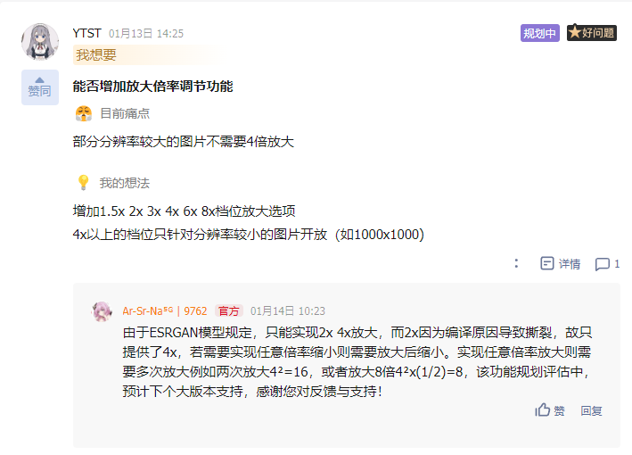
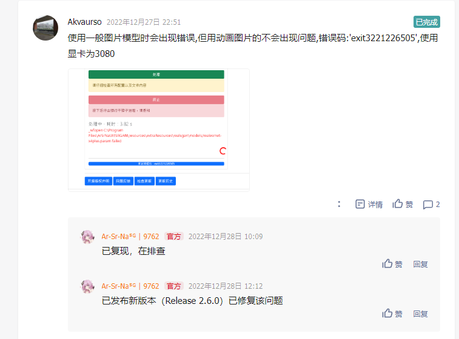
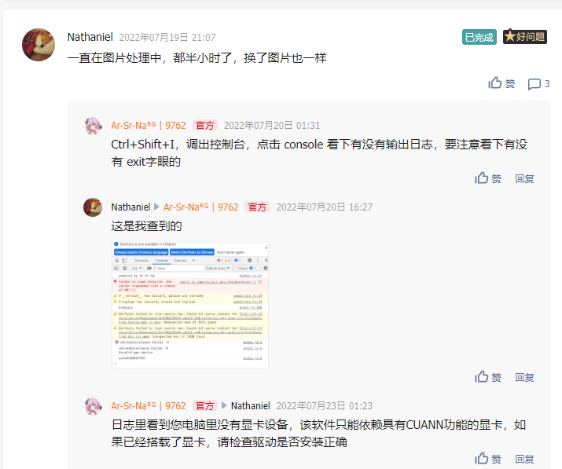
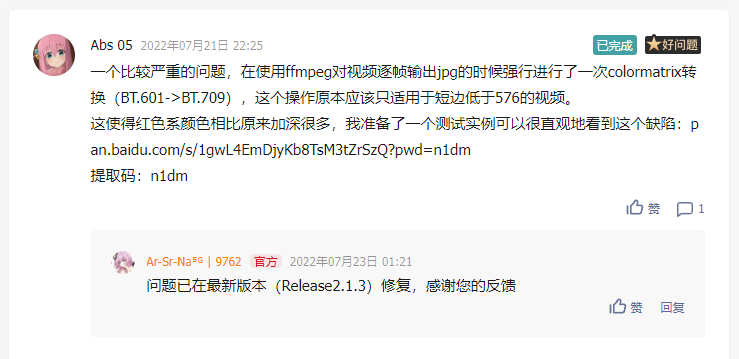

# ArSrNaUI ESRGAN图像超分辨率软件

桌面前端使用 Tauri 2、React、TypeScript 与 Vite，超分算法由内置的 `realesrgan-ncnn-vulkan` 二进制执行。

## 构建本软件

### 前置条件

- Node.js 20 以上与 pnpm
- Rust 稳定版工具链（rustup）
- Windows：MSVC 生成工具与 WebView2 运行时；macOS：Xcode 命令行工具
- 最低系统版本、签名与产物形态仍在评估，见 [迁移 Spec](docs/tauri-migration/spec.md)

### 安装依赖

````shell
git clone https://github.com/ArSrNa/ArESRGAN-GUI.git
cd ArESRGAN-GUI
pnpm install
````

### 开发与打包

````shell
pnpm app:dev      # 准备内置资源 + 启动 Vite + Tauri 窗口
pnpm app:build    # 安装包产物在 src-tauri/target/release/bundle/
````

`pnpm app:dev` 会先执行 `scripts/prepare-tauri-assets.mjs`：把 `public/realsgan` 下的推理二进制按目标 triple 复制到 `src-tauri/binaries/`，并把模型与 DLL 复制到 `src-tauri/resources/`。这两个目录属于构建产物，已被 git 忽略。

| 命令 | 说明 |
| --- | --- |
| `pnpm dev` | 只启动前端 Vite 开发服务器 |
| `pnpm build` | 类型检查 + 前端构建到 `dist/` |
| `pnpm assets` | 只准备 sidecar 与资源 |
| `pnpm changelog` | 生成 CHANGELOG |

## 源代码内容

| 目录 | 内容 |
| --- | --- |
| `src/` | React 界面与页面 |
| `src/lib/desktop.ts` | 前端唯一的 Tauri 调用层（invoke、事件订阅、预览地址） |
| `src-tauri/src/` | Rust 桌面层：资源定位、批次队列、子进程与进度解析、更新检查 |
| `src-tauri/binaries/` | sidecar 推理程序（构建时生成，不入库） |
| `src-tauri/resources/` | 模型与 DLL（构建时生成，不入库） |
| `public/realsgan/` | 推理二进制、模型与 DLL 的唯一真源 |
| `scripts/prepare-tauri-assets.mjs` | 把 `public/realsgan` 准备成 Tauri 可打包的布局 |

## 实现方式与原理

### 前后端通讯

前端不直接驱动推理进程，而是通过 Tauri 命令与事件和 Rust 桌面层交互。所有调用集中在 `src/lib/desktop.ts`。

````ts
import { invoke } from "@tauri-apps/api/core";

// 提交批次：参数在提交时固定
await invoke("start_batch", {
  request: { inputs, model, output },
});
````

````ts
import { listen } from "@tauri-apps/api/event";

// 批次状态推送：等待 / 执行中 / 成功 / 失败 / 已取消
await listen("batch:update", (event) => {
  console.log(event.payload);
});
````

### 任务调度与推理进程

Rust 侧持有批次、队列与子进程。同一时间只允许一个推理进程，重复开始会被拒绝；停止会先记录请求，再终止子进程并取消后续任务。

````rust
let mut command = Command::new(&binary);
command
    .arg("-i").arg(&input)
    .arg("-o").arg(&output)
    .arg("-m").arg(&models_dir)
    .arg("-n").arg(&model);
````

推理进度来自子进程输出中形如 `12.34%` 的整行文本。解析按流增量进行，兼容分段到达与 `\r` / `\n` 两种分隔符；stderr 中的其他内容是日志，既不算错误也不算进度。

### 资源与打包

- 推理二进制以 Tauri sidecar 形式打包，按目标 triple 命名，需先执行 `pnpm assets`。
- 模型与 Windows DLL 作为附加资源打包，运行时通过 Tauri 路径接口定位，不依赖源码目录或工作目录。
- 输出重名时自动改名为 `a_opt(1).png`，不覆盖已有文件。

## 迁移文档

- [Tauri 迁移 Intent](docs/tauri-migration/intent.md)
- [Tauri 迁移 Spec](docs/tauri-migration/spec.md)

# 问题反馈

您可以在这个页面的 issues 提交您的疑问，建议附上日志，控制台（Ctrl+Shift+I调出 或 点击页面上栏的调试控制台）截图

或者到 https://support.qq.com/product/419220 进行业务层面的反馈

# 当您阅读到此时

这是我第一次做electron的应用，存在无数的不足，现在已经一年了，更新了不下10个版本，因为大家的支持与信任让我们有勇气，有理由继续做下去，虽然核心部分不是我所开发的，但作为“第一次”还是有点纪念意义的

2022-1-26 ~ 2023-2-5

我把这个应用发布在b站的时候，未曾想过有如此多关注度，也从没想过这么多的下载量，以至于连夜买了500G的资源包仍然超量

我们开放了用于反馈的通道，本以为只有自己能发现问题，结果确实大家先发现了许多bug，让这个应用愈发完美。

我们也积极响应所有用户的提问，积极修复问题，几乎在1周内就能实现。







大家给了我灵感，减轻了我排查bug的负担，也因为此，我更有动力继续把应用产品做下去

**在此，我诚挚地感谢所有使用本软件的用户，感谢所有为此软件做出贡献的用户，感谢您的信任与支持**

# 暂时不知道还能写什么了

---

**感谢您的支持**
*Powered by Ar-Sr-Na*
